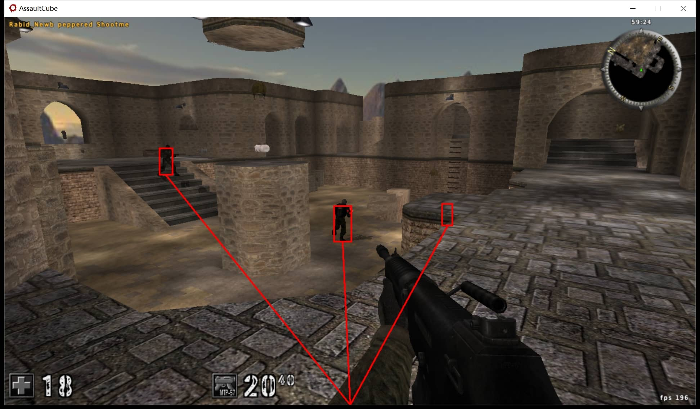

# AssaultCube ESP DLL with Rust 🦀

Applicable game version: **1.3.0.2**

Download: [AssaultCube v1.3.0.2 Lockdown Edition](https://github.com/assaultcube/AC/releases/download/v1.3.0.2/AssaultCube_v1.3.0.2_LockdownEdition.exe)

## How to use

1. Download `ac_esp.dll` from [releases](https://github.com/jerryshell/ac-esp/releases)
2. Run AssaultCube in **Windowed Mode**
3. Inject `ac_esp.dll` into `ac_client.exe` ( You can do this with [System Informer](https://github.com/winsiderss/systeminformer) )

## Build DLL

```sh
cargo build --release --target=i686-pc-windows-msvc
```

or

```sh
cross build --release --target=i686-pc-windows-gnu
```

## Test

```sh
cargo test
```

The overlay test opens a 1920x1080 window, animates a few rectangles, then exits.

## Screenshot



## Related

- [ac-aimbot](https://github.com/jerryshell/ac-aimbot)

The Direct2D overlay lives in `src/overlay.rs`, merged from the former [windows-ez-overlay](https://github.com/jerryshell/windows-ez-overlay) crate.

## References

- [About Windows](https://learn.microsoft.com/en-us/windows/win32/winmsg/about-windows)
- [Rust for Windows](https://kennykerr.ca/rust-getting-started)
- [Windows GDI](https://learn.microsoft.com/en-us/windows/win32/gdi/windows-gdi)
- [Windows Direct2D](https://learn.microsoft.com/en-us/windows/win32/direct2d/direct2d-portal)

## License

[GNU Affero General Public License v3.0](https://choosealicense.com/licenses/agpl-3.0/)
